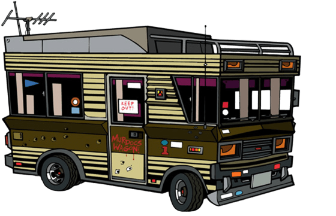

    redesigning this again
     
    
     
    

        

            ${\color{#2272F7}{\textsf{　　nomination(s)}}}$
        

        

            <a href="https://github.com/pt-hall-of-fans">pt-hall-of-fans' murdoc (gorillaz) biggest fan</a>
        

    

     
    all my previous readmes:
      <a href="1firstprevious_README.md">1st</a> - <a href="2secondprevious_README.md">2nd</a> - <a href="3thirdprevious_README.md">3rd</a> - <a href="4fourthprevious_README.md">4th</a> - <a href="5fifthprevious_README.md">5th</a> - <a href="6sixthprevious_README.md">6th</a>
     
     

