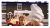
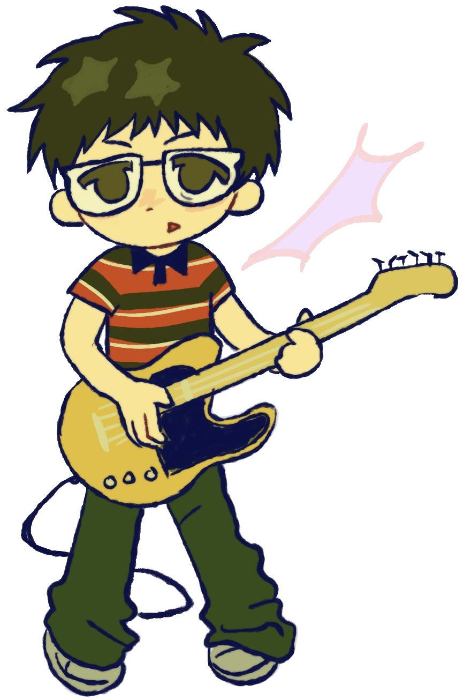
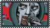
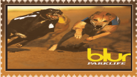
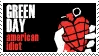
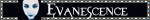
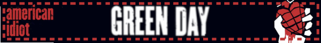
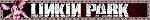

<!-- forking disclaimer
    hello!
    
    yes, you can take inspiration or fork this repository,
    but do star this repository if you are taking inspirations 
    off mine or you have forked this repository
--->
<!-- message
    repository made by me, dotonaro
    
    in any way, this repository is not vibecoded;
    i learnt all of these and taken some tips from
    reddit users, blogs, & github discussions.
    any accusations of me using ai to make this
    repository is false, i type all the syntax(s)
    myself. i also word things out wrong half of
    the time & i mix english (us) with english (uk).
    please stop spreading disinformation or
    misinformation from somebody, thanks!

    bozo exiting
--->
<!-- main markdown -->
<!-- first table ~ primary -->
desktop view + 80~67% zoom level recommended

    

    <table>
        <tr>
            <td>
                

                    
                

            </td>
        </tr>
        <tr>
            <td>
                

                    <table>
                        <td>
                            

                                <kbd>
                                    
                                    
                                </kbd>
                                 
                                <a href="https://git.io/typing-svg">
                                    
                                </a>
                            

                        </td>
                    </table>
                    ${\color{#c0f545}{\textsf{̣̣ 𓏫   ͜͝ | ྀི ⠀𓏼๑ ݂ ۫⠀⠀⠀✿}}}$ ⠀⠀⠀bozo / yoru
                     
                    ⠀
                    ${\color{#c0f545}{\textsf{ ๋࣭⠀}}}$
                    ⠀𓈃⠀ ${\color{#c0f545}{\textsf{they}}}$ / ${\color{#c0f545}{\textsf{them}}}$ ⠀
                    
                    ${\color{#c0f545}{\textsf{⠀ ͜͝ |}}}$
                     
                    ${\color{#c0f545}{\textsf{⠀˚̣̣̣︶ ྀི⠀⠀ ⠀𓎢}}}$ 𓎟 ${\color{#c0f545}{\textsf{𓎡}}}$ ⠀♪   ͜͝ ${\color{#c0f545}{\textsf{࿐}}}$
                     
                    <kbd>
                        
                        
                        
                    </kbd>
                     
                    ${\color{#c0f545}{\textsf{། ͝ ꒹　𓏫　　ּ〪⠀⠀⠀◟ ̣̣̥͜♫᭪ ˚̣̣̣♪}}}$
                     
                    
                    
                     
                    
                     
                    ${\color{#c0f545}{\textsf{───────}}}$
                     
                    <a href="resources/credits.md">credits</a>
                

            </td>
        </tr>
        <tr>
            <td>
                

                    
                

            </td>
        </tr>
    </table>

  
  

 
<!-- second table ~ secondary -->

    

    <table>
        <tr>
            <td>
                

                    
                

            </td>
        </tr>
        <tr>
            <td>
                    

                        

                            ${\color{#c0f545}{\textsf{github things ive done}}}$
                        

                        - <a href="https://github.com/conflux-warp/conflux-warp">conflux-warp/conflux-warp</a>
                         
                        - <a href="firstprevious_README.md">mine previous profile readme (aka crackerisland/crackerisland)</a>
                         
                        - <a href="https://github.com/conflux-warp/conflux-warp.github.io">conflux-warp/conflux-warp.github.io (in progress)</a>
                

            </td>
        </tr>
        <tr>
            <td>
                

                    
                

            </td>
        </tr>
    </table>

 
 
 
 
<!-- miscellaneous markdown -->

    

        
${\color{#c0f545}{\textsf{collection}}}$

        these are all related to what i like or my interest
         
        
        
        
        
         
        
        
         
        
        
        
        
        
        
        
        
    

